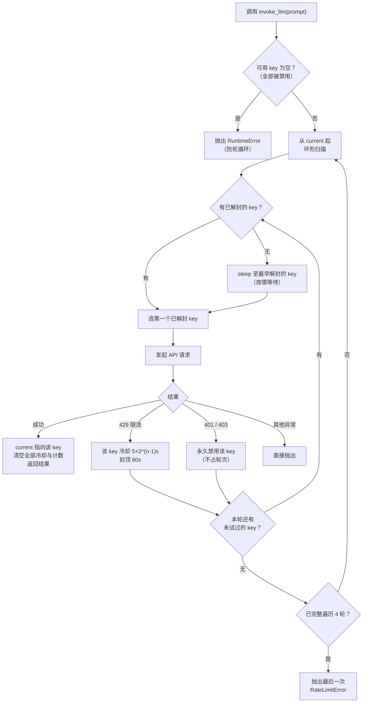

# API Key 池化设计文档

## 1. 背景与目标

项目调用的免费 LLM API（OpenAI 兼容接口）有严格的速率限制，单 key 频繁触发 **429 限流**，导致任务中断或长时间空等。

**目标**：将多个 API key 组成池，限流时自动轮换 + 按 key 独立退避，做到：

1. 个别 key 限流时 **零等待** 切换到其他 key；
2. 全部限流时按**指数退避**等待，且等待是“必要等待”而非盲目 sleep；
3. 坏 key（鉴权失败）自动剔除，不阻断流程；
4. 有上限保护，绝不死循环。

---

## 2. 核心策略（决策与理由）

| 策略 | 内容 | 理由 |
|---|---|---|
| **粘性指针** | 记住上次调用成功的 key（`current`），每次调用从它开始 | 成功的 key 大概率仍健康，减少无效尝试 |
| **per-key 指数退避** | 每个 key 独立计连续限流次数 n，冷却 = `KEY_COOLDOWN × 2^(n-1)`，封顶 60s（即 5→10→20→40→60s） | 限流越久的 key 越该冷落；基数可配 |
| **扫描优先已解封** | 每轮从 `current` 起环形扫描，先找**已解封**的 key 直接调用；全部冷却中才 sleep 到**最早解封**的那个 | 避免“死等 current 而对空闲 key 视而不见” |
| **成功即全部重置** | 任一 key 调用成功：`current` 指向它，**所有** key 的冷却与限流计数清零 | 一个 key 能成功说明服务端窗口已松动，其他 key 大概率恢复；逻辑简单可靠 |
| **401/403 永久禁用** | 鉴权失败的 key 标记为进程内禁用，继续试下一个，**不消耗重试轮次** | 坏 key 无重试价值，且不能让它阻断整个池 |
| **4 轮上限** | 完整遍历 4 轮仍全部失败，抛出最后一次 `RateLimitError` | 防止无限重试；最坏等待约 75s |
| **monotonic 时钟** | 冷却时间戳用 `time.monotonic()` | 避免系统时钟回拨导致冷却永不过期 |

---

## 3. 配置层

### 3.1 `.env`

```ini
MODEL=your-model-name
BASE_URL=https://your-api-host/v1

# key 池：逗号分隔，顺序即优先级
API_KEY_POOLS=sk-aaa,sk-bbb,sk-ccc

REQUEST_TIMEOUT=30.0

# 必须为 0：禁用 OpenAI SDK 内部重试，重试统一由池控制，
# 否则 SDK 会在同一个 key 上原地重试，拖延换 key 速度
MAX_RETRIES=0

# 单 key 限流退避基数（秒）
KEY_COOLDOWN=5
```

### 3.2 `config.py`

```python
def _parse_key_pools() -> list[str]:
    """解析 API_KEY_POOLS（逗号分隔），去重保序；为空时回退到单个 API_KEY"""
    raw = os.getenv("API_KEY_POOLS", "")
    keys = [k.strip() for k in raw.split(",") if k.strip()]
    if not keys and API_KEY:          # 兼容旧配置
        keys = [API_KEY]
    return list(dict.fromkeys(keys))

API_KEYS = _parse_key_pools()
if not API_KEYS:
    raise RuntimeError("未配置任何 API key：请在 .env 中配置 API_KEY_POOLS 或 API_KEY")

KEY_COOLDOWN = float(os.getenv('KEY_COOLDOWN', '5'))
```

---

## 4. 池状态（模块级，跨调用持久）

| 变量 | 类型 | 含义 |
|---|---|---|
| `_clients` | `dict[int, ChatOpenAI]` | key 索引 → 客户端缓存（按 key 复用，不重复建连） |
| `_current` | `int` | 粘性指针：上次成功的 key 索引，初始 0 |
| `_fail_count` | `list[int]` | 每个 key 的连续限流次数（决定退避档位） |
| `_cooldown_until` | `list[float]` | 每个 key 的解封时间戳（monotonic） |
| `_disabled` | `set[int]` | 401/403 永久禁用的 key（进程内） |

保护常量：`MAX_ROUNDS = 4`（遍历上限）、`MAX_COOLDOWN = 60.0`（单 key 冷却封顶）。

---

## 5. 核心算法（伪代码）

```
invoke_llm(prompt):
  last_err = None
  for round in 0..MAX_ROUNDS-1:                      # 一轮 = 从 current 出发的一次完整环形扫描
      order = 从 current 起、排除 disabled 的环形 key 序列
      if order 为空: raise RuntimeError("池内无可用 key")   # ★ 防死循环
      tried = {}
      while len(tried) < len(order):
          target = order 中第一个 未 tried 且已解封 的 key
          if target 不存在:
              target = 未 tried 中冷却最早到期的 key
              sleep(cooldown[target] - now)            # 按需等待，仅此时发生
          tried.add(target)
          try:
              result = client(target).invoke(prompt)
              current = target                          # 粘性指针
              清空所有 fail_count 与 cooldown            # 成功即重置
              return result.content
          except 401/403:
              disabled.add(target)                      # 永久禁用，不占轮次
          except 429 as e:
              last_err = e
              fail_count[target] += 1
              cooldown[target] = now + min(KEY_COOLDOWN × 2^(n-1), 60s)
              # 立即试下一个，不等待
  raise last_err
```

要点：

- **等待只发生在一种情况**：一圈扫描下来没有任何已解封的 key，此时 sleep 到最早解封者。前面 key 的请求耗时通常已覆盖冷却时间，实际 sleep 常为 0。
- 429 后**立即**切下一个，不在原地等待。
- 其他异常（网络、超时、500）**直接抛出**，不进池逻辑。

### 流式接口 `stream_llm` 的区别

- 用 `next(iterator)` 先取首 chunk：**首 chunk 之前**的 429/401 可安全换 key；
- 已开始 yield 之后再遇 429：**标记冷却但不重试**，直接抛出（流式半途换 key 会导致内容重复）。

---

## 6. 异常分类处理

| 异常 | 处理 |
|---|---|
| `RateLimitError`（429） | 该 key 退避递增（5→10→20→40，封顶 60s），立即切下一个 |
| `AuthenticationError` / `PermissionDeniedError`（401/403） | 永久禁用该 key，记错误日志，继续下一个，不占轮次 |
| 其他异常（网络、超时、5xx） | 直接抛出 |
| 流式首 chunk 前 429 | 标记冷却 + 换 key 重试 |
| 流式中途 429 | 标记冷却，抛出（不重试） |

---

## 7. 保护机制汇总

1. **全禁用 → 立即抛 `RuntimeError`**：否则循环里既无可用 key 也无冷却可等，会死循环（这是设计评审阶段发现的致命缺陷）；
2. **4 轮上限**：最坏总等待约 5+10+20+40 = 75s 后抛出，不会无限挂起；
3. **单 key 冷却封顶 60s**：防止 `fail_count` 累积导致冷却膨胀；
4. **`time.monotonic()`**：免疫系统时钟回拨；
5. **扫描优先已解封**：粘性只是优先级，不是强制等待。

---

## 8. 实现映射

| 文件 | 内容 |
|---|---|
| `config.py` | `API_KEYS`（池解析）、`KEY_COOLDOWN`、空池报错 |
| `llm.py` | 池状态 + `invoke_llm` / `stream_llm`；`_get_client`（按 key 缓存）、`_mark_limited`（退避）、`_mark_success`（重置）、`_scan_order`（环形序列）、`_next_target`（已解封优先 / 等最早解封） |
| `.env` | `API_KEY_POOLS`、`KEY_COOLDOWN`、`MAX_RETRIES=0` |

调用方（如 `graph/nodes.py`）**零改动**：只调用 `invoke_llm(prompt)` / `stream_llm(prompt)`，池化对上层透明。

---

## 9. 测试要点（mock 验证清单）

用假 client 替换 `_get_client`，无需真实 API：

1. key#0 返回 429 → 立即切 key#1 成功 → 返回值正确、`current` 更新、冷却清零；
2. 粘性：`current=1` 时新调用第一个请求落在 key#1；
3. 退避递增：同一 key 连续限流，冷却按 5→10→20→40 增长（测试时把 `KEY_COOLDOWN` 改小加速）；
4. 全部 429：4 轮共 n×4 次尝试后抛出 `RateLimitError`；
5. 401 → 进入 `_disabled`，后续调用不再尝试该 key；
6. 全部 401 → 抛出 `RuntimeError("池内无可用 key")`。

---

## 10. 思路图



### 图解说

整张图分三部分理解：

**① 入口保护（顶部）**：每轮开始先检查池里还有没有没被禁用的 key。这是防死循环的闸门——如果所有 key 都因鉴权失败被禁用，再精巧的轮换也没有意义，必须立即失败。

**② 选 key（左中）**：这是池化的核心决策。从粘性指针 `current` 出发环形扫描，**优先用已解封的 key**；只有当所有 key 都在冷却时，才 sleep 到最早解封的那个。这保证了“等待永远是必要的等待”——只要池里有一个 key 能立刻用，就绝不空等。

**③ 结果分派（右侧三条路）**：
- **成功路**（绿色出口）：不仅返回结果，还做两件事——`current` 粘到该 key（下次调用从它开始），清空全部冷却（一个 key 能成功说明服务端窗口松动了，其他 key 一并“赦免”）；
- **429 路**：只惩罚犯事的 key——冷却时间按它自己的连续失败次数指数增长（5→10→20→40，封顶 60s），然后立刻试下一个，**当前这次调用不等待**；
- **401/403 路**：永久性错误没有重试价值，直接踢出池，且不消耗 4 轮的重试预算。

外层循环最多 4 轮。一轮的定义是“从 `current` 出发把可用 key 都试一遍”；4 轮全灭才放弃，把最后一次 429 抛给上层。

把三条路合起来看，整个池的行为可以概括成一句话：**平时粘在健康的 key 上，谁限流就冷落谁一小会儿，谁鉴权失败就永久开除，全军覆没也有明确的失败边界。**
