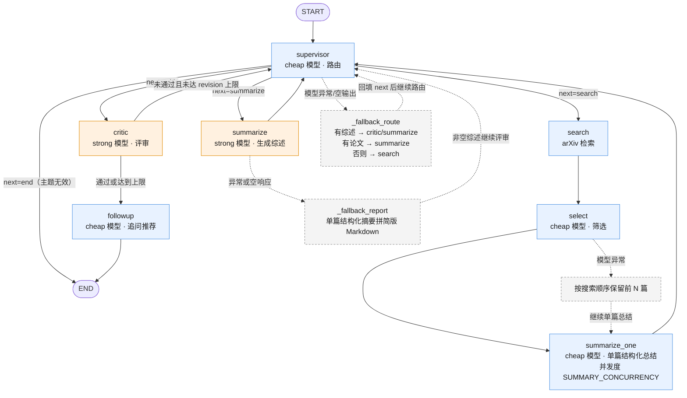
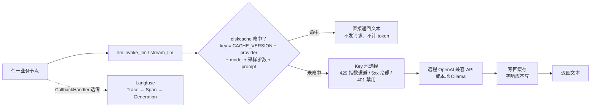

# Paper Research Agent

> 输入一个研究主题，自动检索 arXiv 论文、筛选并逐篇结构化总结，最终生成一份可评审、可追问的中文综述报告。

<details class="readme-toc">
<summary>目录</summary>
<div class="toc-body">
<div><a href="#项目定位">项目定位</a></div>
<div><a href="#技术栈">技术栈</a></div>
<div><a href="#核心特性">核心特性</a></div>
<div><a href="#架构与流程">架构与流程</a></div>
<div class="sub"><a href="#主流程">主流程</a></div>
<div class="sub"><a href="#节点职责与失败策略">节点职责与失败策略</a></div>
<div class="sub"><a href="#llm-调用路径">LLM 调用路径</a></div>
<div><a href="#快速开始">快速开始</a></div>
<div class="sub"><a href="#1-前置依赖">1. 前置依赖</a></div>
<div class="sub"><a href="#2-安装依赖">2. 安装依赖</a></div>
<div class="sub"><a href="#3-配置-env">3. 配置 .env</a></div>
<div class="sub"><a href="#4-cli-跑通">4. CLI 跑通</a></div>
<div class="sub"><a href="#5-启动-http-服务">5. 启动 HTTP 服务</a></div>
<div class="sub"><a href="#6-docker">6. Docker</a></div>
<div><a href="#使用说明">使用说明</a></div>
<div class="sub"><a href="#cli-参数">CLI 参数</a></div>
<div class="sub"><a href="#http-接口">HTTP 接口</a></div>
<div><a href="#配置参数">配置参数</a></div>
<div class="sub"><a href="#模型路由">模型路由</a></div>
<div class="sub"><a href="#远程调用与限流">远程调用与限流</a></div>
<div class="sub"><a href="#本地模型ollama">本地模型（Ollama）</a></div>
<div class="sub"><a href="#搜索与总结">搜索与总结</a></div>
<div class="sub"><a href="#可观测性langfuse">可观测性（Langfuse）</a></div>
<div class="sub"><a href="#缓存与成本">缓存与成本</a></div>
<div><a href="#可靠性设计">可靠性设计</a></div>
<div class="sub"><a href="#模型分级">模型分级</a></div>
<div class="sub"><a href="#三层兜底">三层兜底</a></div>
<div class="sub"><a href="#缓存策略">缓存策略</a></div>
<div class="sub"><a href="#key-池与限流">Key 池与限流</a></div>
<div class="sub"><a href="#输入安全与报告校验">输入安全与报告校验</a></div>
<div class="sub"><a href="#混沌工程">混沌工程</a></div>
<div><a href="#可观测性与成本">可观测性与成本</a></div>
<div class="sub"><a href="#langfuse">Langfuse</a></div>
<div class="sub"><a href="#本次-run-统计">本次 run 统计</a></div>
<div><a href="#测试">测试</a></div>
<div><a href="#设计决策与踩坑">设计决策与踩坑</a></div>
<div class="sub"><a href="#1-为什么用-langgraph">1. 为什么用 LangGraph</a></div>
<div class="sub"><a href="#2-为什么做模型分级">2. 为什么做模型分级</a></div>
<div class="sub"><a href="#3-缓存为什么这样设计">3. 缓存为什么这样设计</a></div>
<div class="sub"><a href="#4-兜底为什么选择降级而不是重试到底">4. 兜底为什么选择降级</a></div>
<div class="sub"><a href="#5-429-与单-key-冷却的取舍">5. 429 与单 key 冷却</a></div>
<div class="sub"><a href="#6-混沌开关为什么复用重试链路">6. 混沌开关复用重试链路</a></div>
<div class="sub"><a href="#7-langfuse-为什么用双-key-即启用">7. Langfuse 双 key 即启用</a></div>
<div><a href="#已知限制">已知限制</a></div>
<div><a href="#项目结构">项目结构</a></div>
<div><a href="#参考">参考</a></div>
</div>
</details>

<style>
.readme-toc {
  margin: 14px 0 18px;
  padding: 10px 14px;
  border: 1px solid #d0d7de;
  border-radius: 8px;
  background: #f6f8fa;
  font-size: 13px;
  line-height: 1.7;
}
.readme-toc summary {
  cursor: pointer;
  font-weight: 600;
  color: #24292f;
  user-select: none;
}
.readme-toc .toc-body {
  margin-top: 8px;
  padding-top: 8px;
  border-top: 1px solid #d8dee4;
}
.readme-toc a {
  display: block;
  padding: 2px 0;
  color: #0969da;
  text-decoration: none;
}
.readme-toc a:hover {
  text-decoration: underline;
}
.readme-toc .sub a {
  padding-left: 14px;
  color: #57606a;
}
@media (min-width: 1600px) {
  .readme-toc {
    position: fixed;
    top: 88px;
    right: 24px;
    width: 240px;
    max-height: 72vh;
    overflow-y: auto;
    margin: 0;
    background: #ffffff;
    box-shadow: 0 8px 24px rgba(140, 149, 159, 0.2);
    z-index: 10;
  }
}
@media (prefers-color-scheme: dark) {
  .readme-toc {
    background: #161b22;
    border-color: #30363d;
  }
  .readme-toc summary {
    color: #c9d1d9;
  }
  .readme-toc .toc-body {
    border-top-color: #30363d;
  }
  .readme-toc a {
    color: #58a6ff;
  }
  .readme-toc .sub a {
    color: #8b949e;
  }
}
@media print {
  .readme-toc {
    display: none;
  }
}
</style>

## 项目定位

| 维度 | 说明 |
| --- | --- |
| 解决什么问题 | 把「搜论文 → 读摘要 → 挑重点 → 拼综述 → 自检」串成一条可观测的自动化流水线，减少人工检索与整理成本 |
| 输入 | 研究主题（≤100 字符）、单次搜索篇数（1–50）、最终保留篇数（1–10）、最大评审轮数 |
| 输出 | Markdown 综述报告；终端/SSE 侧同时给出评审意见、追问方向、数字校验结果、缓存命中与 token/成本统计 |
| 不做什么 | 默认只基于 arXiv 摘要（前 200 字）总结，不做 PDF 全文精读；不做引用格式排版；`followup` 只给后续方向建议，不是多轮对话 |

## 技术栈

| 层 | 选型 |
| --- | --- |
| 工作流编排 | LangGraph（状态图 + 条件边 + 递归上限） |
| 模型调用 | `langchain-openai` / OpenAI 兼容 API（ModelScope、Cloudflare Workers AI、DeepSeek 等）；本地模式走 Ollama |
| 论文检索 | `arxiv` Python 包（按相关性排序） |
| 服务端 | FastAPI + Uvicorn（SSE 流式返回） |
| 缓存 | `diskcache`（LLM 结果磁盘缓存） |
| 可观测性 | Langfuse（可选，双 key 齐全才启用） |
| 工具层 | `pdfplumber`（预留 PDF 全文提取，主流程默认不用） |
| 测试 | pytest（离线单测 + `live` 标记的真实链路用例） |
| 交付 | Docker / docker-compose；CLI 与 HTTP 两种入口 |

## 核心特性

- **7 节点工作流**：`supervisor → search → select → summarize_one → summarize → critic → followup`，条件边控制检索、评审与重试。
- **模型分级**：路由/筛选/单篇总结/追问用 cheap 模型，综述生成与评审用 strong 模型，兼顾成本与质量。
- **三层兜底**：路由、筛选、综述任一处模型连续失败都不再直接中止，分别降级为确定性路由、顺序保留、单篇摘要汇总。
- **Key 池与限流**：多 key 轮换、单 key 指数退避、401/403 永久禁用、可选全局 RPM 滑动窗口。
- **磁盘缓存**：按 `版本 + provider + 模型 + 采样参数 + prompt` 生成键；空响应不写入、不命中。
- **并发总结**：`SUMMARY_CONCURRENCY`（1–8）控制单篇总结并发度，结果顺序与输入严格对齐。
- **输入安全**：控制字符清理、主题长度上限、注入可疑短语标记（只告警不误杀）。
- **数字事后校验**：报告中的量化数字必须能在喂给模型的摘要语料中找到，否则告警。
- **可观测与成本**：Langfuse 调用链（Trace / Span / Generation）；每次 run 输出 token、调用次数、缓存命中与估算成本。
- **混沌工程**：`CHAOS_FAILURE_RATE` 按概率注入可重试超时，默认关闭，仅远程模式生效。

## 架构与流程

### 主流程

> 节点与边严格对应 [`graph/graph_compile.py`](graph/graph_compile.py)；蓝色为 cheap 模型，橙色为 strong 模型，虚线为降级分支。



### 节点职责与失败策略

| 节点 | 模型档位 | 职责 | 失败时 |
| --- | --- | --- | --- |
| `supervisor` | cheap | 根据论文数、综述状态、上次决策选择下一步；`summary`/`papers` 已存在时走确定性护栏，不调用模型 | 异常或空输出 → `_fallback_route` 按状态表回退；主题无效 → `end` |
| `search` | 无 | 调用 arXiv 检索，按 URL 去重后合并进论文池 | 请求失败返回已获取的部分结果（可能为空），不抛异常 |
| `select` | cheap | 从候选中选最相关的 N 篇，优先同子领域，不足时跨领域补齐 | 模型异常或 JSON 解析失败 → 按搜索顺序保留前 N 篇 |
| `summarize_one` | cheap | 并发提取每篇的 `problem / method / result / limitation` | 单篇失败保留空结构，不拖垮整批 |
| `summarize` | strong | 流式生成综述 Markdown | 异常或空响应 → `_fallback_report` 用单篇结构化摘要拼简版报告 |
| `critic` | strong | 评审综述，输出「通过」或具体修改意见 | 失败返回降级评审文本；流程仍受 revision 上限约束，不会无限循环 |
| `followup` | cheap | 基于主题与综述推荐后续研究方向 | 失败返回占位提示，不影响报告 |

### LLM 调用路径

> 这是 `invoke_llm / stream_llm` 的内部细节，不是图节点；用于说明缓存与可观测性的接入位置。



一次 `graph.invoke` 对应 Langfuse 的一条 Trace；每个图节点是一个 Span；每次真实 LLM 调用是一个 Generation（缓存命中不产生 Generation）。

## 快速开始

### 1. 前置依赖

- Python ≥ 3.10（Docker 镜像基于 `python:3.13-slim`）
- 可访问 arXiv 与所选的 OpenAI 兼容模型服务
- 可选：Docker 20+；本地模型需要 Ollama

### 2. 安装依赖

```bash
git clone https://github.com/2144792703/Paper-Research-Agent.git
cd Paper-Research-Agent

# Windows PowerShell
python -m venv .venv
.\.venv\Scripts\Activate.ps1

# macOS / Linux
python3 -m venv .venv
source .venv/bin/activate

pip install -r requirements.txt
```

### 3. 配置 `.env`

```powershell
# Windows PowerShell
Copy-Item .env.example .env
```

```bash
# macOS / Linux
cp .env.example .env
```

远程模式（`MODEL_PROVIDER=remote`）至少填写：

```dotenv
MODEL_PROVIDER=remote
MODEL=your-model-name
BASE_URL=https://api.example.com/v1
API_KEY_POOLS=key1,key2
# 或者只用一个 key：
# API_KEY=key1
```

可选：

```dotenv
MODEL_CHEAP=your-cheap-model          # 留空回退 MODEL
CHEAP_MODEL_DISABLE_THINKING=1        # 关掉轻量模型的思考输出
LANGFUSE_PUBLIC_KEY=                  # 与 SECRET_KEY 同时填写才启用
LANGFUSE_SECRET_KEY=
```

说明：

- `.env` 已在 `.gitignore` 中，不要把真实 key 提交到仓库。
- 远程模式必须提供至少一个 key，否则启动时直接报错。
- 不填 `BASE_URL` 时使用 SDK 默认地址；实际部署建议显式填写。
- key 池细节见 [API_KEY_POOL.md](API_KEY_POOL.md)。

### 4. CLI 跑通

```bash
python main.py --topic "graph neural network" --papers 5
```

预期流程：搜索 → 筛选 → 并发单篇总结 → 生成综述 → 评审（最多 2 轮）→ 追问推荐。终端会输出报告、评审意见、数字校验结果、缓存命中和本次 run 统计。

清空本地 LLM 缓存（改 prompt / 模型后旧结果回放时用）：

```bash
python main.py --clear-cache
```

> Windows 下不要手动删除 `.cache/cache.db`，文件锁会导致删除失败；用上面的命令。

### 5. 启动 HTTP 服务

```bash
python -m uvicorn server:app --host 0.0.0.0 --port 8000
```

```bash
curl -N -X POST http://127.0.0.1:8000/research \
  -H "Content-Type: application/json" \
  -d "{\"topic\":\"graph neural network\",\"papers\":5}"
```

SSE 事件：

| 事件 | 时机 | 内容 |
| --- | --- | --- |
| `progress` | 请求进入 | `{"step":"start","topic":"..."}` |
| `done` | 正常结束 | 报告前 2000 字、`trace_id`、`usage`、`report_warnings` |
| `timeout` | 超过 360s | 超时提示 |
| `partial` | 内部异常 | 通用错误提示（详情只进服务端日志） |

服务端同一时刻只允许一个研究任务执行（`asyncio.Lock`），并发请求会排队，避免统计互相清零和重复消耗配额。

健康检查：

```bash
curl http://127.0.0.1:8000/health
```

### 6. Docker

```bash
docker compose up --build
```

- 默认读取项目根目录的 `.env`。
- `.cache` 挂载到宿主机，容器重建后缓存仍可复用。
- 容器内 `127.0.0.1` 指向容器自身；如需本地 Ollama，请把 `OLLAMA_HOST` 改为 `http://host.docker.internal:11434` 并确保宿主机可访问。

## 使用说明

### CLI 参数

| 参数 | 说明 | 默认 |
| --- | --- | --- |
| `--topic` | 研究主题；不填则交互输入 | 无 |
| `--papers` | 最终保留论文数，超出 1–10 自动收敛并提示 | `.env` 的 `KEEP_PAPERS`（5） |
| `--search-count` | 单次搜索拉取数，超出 1–50 自动收敛并提示 | `.env` 的 `SEARCH_MAX_RESULTS`（15） |
| `--max-retries` | 最大评审轮数 | 2 |
| `--clear-cache` | 清空本地 LLM 缓存后退出 | 关闭 |

### HTTP 接口

| 方法 | 路径 | 说明 |
| --- | --- | --- |
| `POST` | `/research` | 请求体 `{"topic": "...", "papers": 5, "max_retries": 2}`，返回 SSE 流 |
| `GET` | `/health` | 健康检查 |

约束：`topic` 长度 1–100；`papers` 范围 1–10；服务端超时 360s。

## 配置参数

> 下表默认值以 [`config.py`](config.py) 为准。`.env.example` 是演示配置，其中 `REQUEST_TIMEOUT=180.0`、`MAX_RETRIES=0`、`RPM_LIMIT=0` 是示例覆盖值，不是代码默认值。

### 模型路由

| 参数 | 默认值 | 取值 / 说明 |
| --- | --- | --- |
| `MODEL_PROVIDER` | `remote` | `remote` / `local`；非法值启动即报错 |
| `MODEL` | 无 | 远程主模型名；`remote` 模式使用 |
| `BASE_URL` | 无 | OpenAI 兼容接口地址 |
| `API_KEY_POOLS` | 无 | 逗号分隔的 key 池；为空时回退 `API_KEY` |
| `API_KEY` | 无 | 单 key 写法；`remote` 模式必须至少配置一种 key |
| `MODEL_CHEAP` | 空（回退 `MODEL`） | 轻量节点模型 |
| `CHEAP_MODEL_DISABLE_THINKING` | `1` | `0` / `1`；仅远程且轻量模型与主模型不同时生效 |

### 远程调用与限流

| 参数 | 默认值 | 取值 / 说明 |
| --- | --- | --- |
| `REQUEST_TIMEOUT` | `600.0` | 单次请求超时（秒） |
| `MAX_RETRIES` | `2` | 传给 ChatOpenAI SDK 的重试次数 |
| `KEY_COOLDOWN` | `5` | 429 退避基数（秒），按 5→10→20→40 递增，封顶 60s |
| `RPM_LIMIT` | `10` | 全局跨 key 每分钟请求上限；`0` 关闭节流 |
| `RPM_WINDOW` | 固定 `60.0` | 滑动窗口长度（秒），不可通过环境变量修改 |
| `CHAOS_FAILURE_RATE` | `0.0` | `0`–`1`；仅远程模式生效，默认关闭 |

### 本地模型（Ollama）

| 参数 | 默认值 | 取值 / 说明 |
| --- | --- | --- |
| `OLLAMA_HOST` | `http://127.0.0.1:11434` | Ollama 服务地址 |
| `OLLAMA_MODEL` | `qwen2.5:7b-instruct-q5_K_M` | 本地主模型 |
| `OLLAMA_MODEL_CHEAP` | 空（回退 `OLLAMA_MODEL`） | 本地轻量节点模型 |
| `OLLAMA_TIMEOUT` | `300` | 本地请求超时（秒） |

### 搜索与总结

| 参数 | 默认值 | 取值 / 说明 |
| --- | --- | --- |
| `SEARCH_MAX_RESULTS` | `15` | 1–50；单次 arXiv 拉取数量 |
| `KEEP_PAPERS` | `5` | 1–10；筛选后最终保留数量 |
| `SUMMARY_CONCURRENCY` | `3` | 1–8；单篇总结并发度，本地模型建议 1–2 |

### 可观测性（Langfuse）

| 参数 | 默认值 | 取值 / 说明 |
| --- | --- | --- |
| `LANGFUSE_PUBLIC_KEY` | 空 | 与 `SECRET_KEY` 同时存在才启用 |
| `LANGFUSE_SECRET_KEY` | 空 | 缺任一 key 自动跳过上报 |
| `LANGFUSE_BASE_URL` | `https://cloud.langfuse.com` | SDK 优先读取；兼容旧写法 `LANGFUSE_HOST` |

### 缓存与成本

| 参数 | 默认值 | 取值 / 说明 |
| --- | --- | --- |
| `CACHE_ENABLED` | `1` | `0/false/no/off` 关闭缓存 |
| `CACHE_DIR` | `./.cache` | 缓存目录 |
| `CACHE_VERSION` | `1` | prompt/缓存格式/影响输出的代码变更时 +1，强制旧缓存失效 |
| `LLM_TEMPERATURE` | 未设置 | 留空不向 API 传参；参与缓存键 |
| `LLM_TOP_P` | 未设置 | 留空不向 API 传参；参与缓存键 |
| `MODEL_PRICES_PATH` | `prices/model_prices_and_context_window.json` | litellm 单价表 |
| `MODEL_PRICE_INPUT_PER_1M` | 未设置 | 美元/百万 token；与输出单价同时填写才生效 |
| `MODEL_PRICE_OUTPUT_PER_1M` | 未设置 | 美元/百万 token |
| `USD_TO_CNY` | 未设置 | 可选人民币展示汇率 |

## 可靠性设计

### 模型分级

| 档位 | 使用节点 | 目的 |
| --- | --- | --- |
| cheap | `supervisor`、`select`、`summarize_one`、`followup` | 高频、结构化任务，压低成本与延迟 |
| strong | `summarize`、`critic` | 决定最终报告质量，使用更强的生成与评审能力 |

### 三层兜底

| 位置 | 触发条件 | 降级结果 |
| --- | --- | --- |
| `supervisor` | 模型异常或空输出 | 按状态表确定性回退：有综述 → `critic`/`summarize`；有论文 → `summarize`；否则 `search` |
| `select` | 模型异常或 JSON 解析失败 | 按搜索顺序保留前 N 篇 |
| `summarize` | 流式异常或返回空串 | 用单篇结构化摘要拼简版 Markdown；无摘要时输出「研究未能完成」提示 |

此外，`summarize_one` 单篇失败保留空结构，`critic` 失败返回降级文本但不阻断报告，`followup` 失败返回占位提示。

### 缓存策略

- 键 = `sha256(CACHE_VERSION + provider + model + temperature + top_p + 规范化 prompt)`；思考/非思考模式的缓存键额外加 `|no-think` 隔离。
- 空字符串或纯空白响应不写入缓存；历史空值在读取时会被删除并视为未命中。
- 修改 prompt 文字会自动换键；修改影响输出的代码逻辑时需要手动提升 `CACHE_VERSION`。
- 缓存命中不产生网络请求，也不产生 Langfuse Generation。

### Key 池与限流

- 429：单 key 指数退避（`KEY_COOLDOWN × 2^(n-1)`，封顶 60s），随后切换下一个 key。
- 5xx / 网络错误：固定冷却 `KEY_COOLDOWN` 后换 key。
- 401 / 403：该 key 进程内永久禁用。
- 最多完整遍历 4 轮（`MAX_ROUNDS=4`），仍失败才向业务层抛异常。
- `RPM_LIMIT > 0` 时启用全局滑动窗口 + 最小请求间隔，所有 key 共享同一窗口。

### 输入安全与报告校验

- 入口统一 `sanitize_topic`：去掉首尾空白与不可见控制字符；主题长度上限 100，CLI 与 API 一致。
- 命中「忽略以上指令」「system prompt」「api key」等可疑短语时只打 warning，不硬拦截，避免误杀正常论文标题。
- 报告生成后做数字校验：报告中出现的量化数字必须能在摘要语料中找到，否则输出警告供人工复核。

### 混沌工程

```dotenv
CHAOS_FAILURE_RATE=0.2
```

- 在请求发出前按概率注入 `ChaosInjectedError`（属于可重试超时），复用现有的换 key / 退避 / 重试逻辑，业务节点无需改动。
- 默认 `0.0` 关闭；仅远程模式生效。
- 开关打开时，终端会额外打印注入次数、逻辑调用数、请求尝试数、重试数与最终是否出报告。

## 可观测性与成本

### Langfuse

- 只有 `LANGFUSE_PUBLIC_KEY` 与 `LANGFUSE_SECRET_KEY` 同时存在时才启用，无需额外开关。
- 通过 `graph.invoke(..., config=trace_config(topic))` 注入 `CallbackHandler`，业务节点不写埋点。
- 层级：Trace（一次研究）→ Span（每个图节点）→ Generation（每次真实 LLM 调用）。
- CLI 结束会打印 trace id；SDK 初始化失败只降级为不上报，不影响主流程。

### 本次 run 统计

每次 run 结束输出：

- 总耗时
- 缓存 hit / miss
- input / output / total tokens
- LLM 调用次数与缓存命中次数
- 分模型 token
- 估算成本（可计价部分 + 未计价模型提示；可选人民币展示）

价格表来自 litellm 的 `model_prices_and_context_window.json`。表中查不到的模型只报 token，不估算金额；也可以用 `MODEL_PRICE_INPUT_PER_1M` / `MODEL_PRICE_OUTPUT_PER_1M` 手动补单价。

## 测试

```bash
# 离线全量回归（不发网络请求）
python -m pytest
# 19 passed, 5 deselected

# 真实链路用例（需要 .env 与可用模型额度）
python -m pytest -m live
```

- `test/report_check_test.py`：报告数字校验（12 个）
- `test/chaos_test.py`：混沌注入、重试消化、三层兜底、统计并发安全（7 个）
- `test/security_injection_test.py`：真实链路注入用例，标记为 `live`，默认不跑
- `test/` 下的 `full_run_test.py`、`smoke_test.py`、`selection_test.py`、`summary_test.py`、`tools_test.py` 是脚本式验收，按需手动执行：`python test/xxx.py`

`pytest.ini` 已配置 `testpaths=test`、默认 `-m "not live"`，并用 `collect_ignore` 排除会在导入阶段发真实请求的脚本。

## 设计决策与踩坑

### 1. 为什么用 LangGraph

流程包含检索、筛选、并发总结、生成、评审、重试与追问，天然是状态机。LangGraph 的条件边把「下一步去哪」显式化，节点级失败可以就地降级，配合 `revision_count`/`critique_times` 与确定性护栏避免死循环；同时每个节点天然是一个 Span，便于接入 Langfuse。

### 2. 为什么做模型分级

路由和筛选是高频、短输出任务，用 cheap 模型足够；综述与评审决定最终质量，用 strong 模型。轻量模型默认关闭思考（`CHEAP_MODEL_DISABLE_THINKING=1`），减少无意义的推理 token 与延迟。

### 3. 缓存为什么这样设计

缓存键覆盖版本、provider、模型、采样参数与规范化 prompt，避免换模型或换提供方后错误命中。空响应不写入、历史空值读取时删除，是为了修复「模型返回空 → 空值入缓存 → supervisor 反复要求重写」的死循环。Windows 下缓存文件有锁，清缓存统一走 `python main.py --clear-cache`。

### 4. 兜底为什么选择「降级」而不是「重试到底」

评审、追问、单篇总结属于非关键路径，综述生成失败时也仍有单篇结构化摘要可用。与其让一次模型抖动毁掉整次 run，不如让流程带着质量标记继续，把异常类型留在日志里供排查。代价是降级报告质量会下降，需要人工复核。

### 5. 429 与单 key 冷却的取舍

多 key 时按指数退避 + 轮换可以平滑限流；单 key 时 4 轮遍历内多次注入/限流会耗尽重试，这是已知边界。`RPM_LIMIT` 可以提前节流，代价是整体变慢。遇到 ModelScope `code 1305` 这类模型侧过载，换 `MODEL_CHEAP`、换提供方或等待通常比继续重试更有效。

### 6. 混沌开关为什么复用重试链路

`ChaosInjectedError` 继承自 `APITimeoutError`，直接走现有的 5xx/网络错误分支，能同时验证「换 key、退避、重试、兜底」四件事。默认关闭、仅远程生效，避免影响本地与生产；统计字段加锁，保证并发总结时的数字准确。

### 7. Langfuse 为什么用「双 key 即启用」

观测属于可选能力，缺任一 key 就自动跳过，避免为了关闭观测再加一个开关。接入点集中在 `observability.py`，业务节点保持干净；上报失败只降级为不上报，绝不阻断主流程。

## 已知限制

- 默认只用 arXiv 摘要（前 200 字），不保证覆盖论文全文；`tools/pdf_tool.py` 提供全文提取能力，但未接入主流程。
- 综述质量与评审效果取决于所选模型；免费额度可能触发 429，需要换 key/提供方或降低并发。
- 价格表是静态快照，新模型可能查不到单价，此时只统计 token。
- `followup` 只是后续方向建议，不构成多轮对话。
- HTTP 服务为单实例内存态：同一时刻只跑一个研究任务，超时 360s，没有任务持久化与断点恢复。
- 输入注入防护只覆盖入口侧可疑短语标记；论文标题/摘要中的间接注入不在当前防线内。

## 项目结构

```text
.
├── main.py                 # CLI 入口：参数解析、输入校验、报告与统计输出
├── server.py               # FastAPI 入口：POST /research（SSE）、GET /health
├── config.py               # 全部环境变量与默认值/收敛逻辑
├── graph/
│   ├── graph_compile.py    # LangGraph 节点、边与条件路由
│   ├── nodes.py            # 7 个节点实现与三层兜底
│   └── state.py            # SupervisorState 定义
├── models/
│   ├── __init__.py         # provider 路由与 invoke_llm / stream_llm 导出
│   ├── remote.py           # 远程 OpenAI 兼容调用、key 池、重试、混沌
│   └── local.py            # 本地 Ollama 调用
├── tools/
│   ├── arxiv_tool.py       # arXiv 检索
│   └── pdf_tool.py         # PDF 全文提取（工具层预留）
├── cache.py                # diskcache 缓存与命中统计
├── usage.py                # token / 成本统计
├── observability.py        # Langfuse 接入
├── security.py             # 输入清理与注入标记
├── report_check.py         # 报告数字事后校验
├── eval.py                 # 批量主题评估脚本
├── prices/                 # litellm 单价表
├── test/                   # 离线单测 + live 用例 + 脚本式验收
├── Dockerfile
├── docker-compose.yml
├── pytest.ini
└── .env.example
```

## 参考

- [LangGraph](https://github.com/langchain-ai/langgraph)
- [arXiv API](https://info.arxiv.org/help/api/index.html)
- [litellm model prices](https://github.com/BerriAI/litellm/blob/main/model_prices_and_context_window.json)
- [Langfuse](https://langfuse.com/docs)
