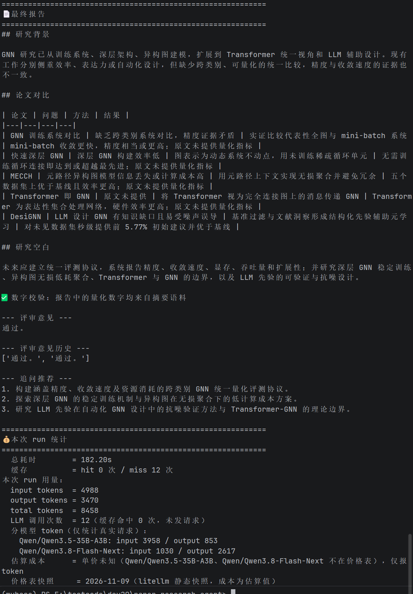
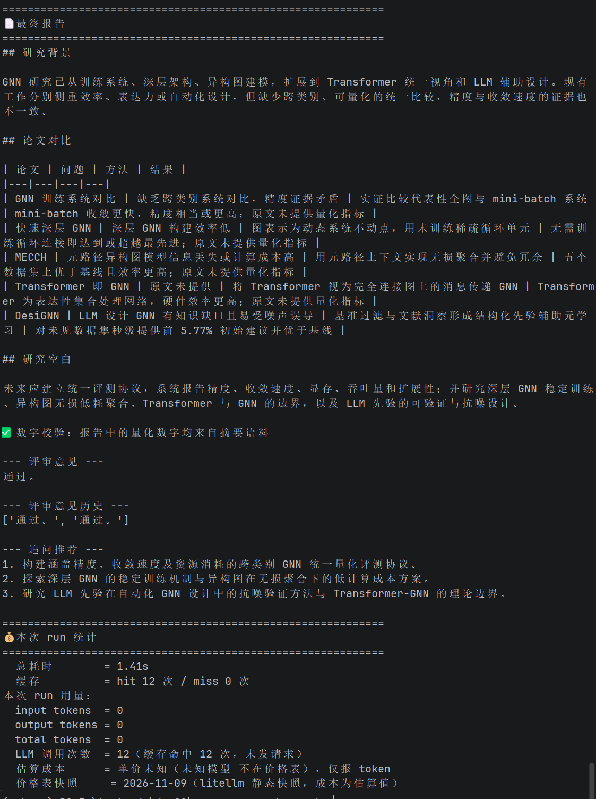
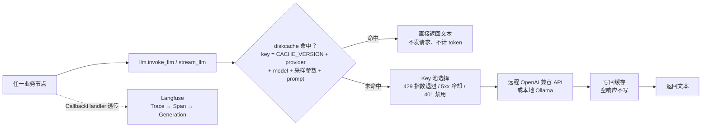

# Paper Research Agent

> 输入一个研究主题，自动检索 arXiv 论文、筛选并逐篇结构化总结，最终生成一份可评审、可追问的中文综述报告。

<details>
<summary>目录（点击展开）</summary>

- [项目定位](#项目定位)
- [技术栈](#技术栈)
- [核心特性](#核心特性)
- [效果演示](#效果演示)
  - [缓存命中对比](#缓存命中对比)
  - [报告节选](#报告节选)
- [架构与流程](#架构与流程)
  - [主流程](#主流程)
  - [节点职责与失败策略](#节点职责与失败策略)
  - [LLM 调用路径](#llm-调用路径)
- [快速开始](#快速开始)
  - [1. 前置依赖](#1-前置依赖)
  - [2. 安装依赖](#2-安装依赖)
  - [3. 配置 .env](#3-配置-env)
  - [4. CLI 跑通](#4-cli-跑通)
  - [5. 启动 HTTP 服务](#5-启动-http-服务)
  - [6. Docker](#6-docker)
- [使用说明](#使用说明)
  - [CLI 参数](#cli-参数)
  - [HTTP 接口](#http-接口)
- [配置参数](#配置参数)
  - [模型路由](#模型路由)
  - [远程调用与限流](#远程调用与限流)
  - [本地模型（Ollama）](#本地模型ollama)
  - [搜索与总结](#搜索与总结)
  - [可观测性（Langfuse）](#可观测性langfuse)
  - [缓存与成本](#缓存与成本)
- [可靠性设计](#可靠性设计)
  - [模型分级](#模型分级)
  - [三层兜底](#三层兜底)
  - [缓存策略](#缓存策略)
  - [Key 池与限流](#key-池与限流)
  - [输入安全与报告校验](#输入安全与报告校验)
  - [混沌工程](#混沌工程)
- [可观测性与成本](#可观测性与成本)
  - [Langfuse](#langfuse)
  - [本次 run 统计](#本次-run-统计)
- [测试](#测试)
- [设计决策与踩坑](#设计决策与踩坑)
- [已知限制](#已知限制)
- [项目结构](#项目结构)
- [参考](#参考)

</details>

## 项目定位

| 维度 | 说明 |
| --- | --- |
| 解决什么问题 | 把「搜论文 → 读摘要 → 挑重点 → 拼综述 → 自检」串成一条可观测的自动化流水线，减少人工检索与整理成本 |
| 输入 | 研究主题（≤100 字符）、单次搜索篇数（1–50）、最终保留篇数（1–10）、最大评审轮数 |
| 输出 | Markdown 综述报告；终端或 SSE 同时输出评审意见、追问方向、数字校验结果、缓存命中与 token/成本统计 |
| 不做什么 | 只使用 arXiv 摘要，不下载或解析 PDF 全文；不做引用格式排版；`followup` 只给后续方向建议，不是多轮对话 |

## 技术栈

| 层 | 选型 |
| --- | --- |
| 工作流编排 | LangGraph（状态图 + 条件边 + 递归上限） |
| 模型调用 | `langchain-openai` / OpenAI 兼容 API（ModelScope、Cloudflare Workers AI、DeepSeek 等）；本地模式走 Ollama |
| 论文检索 | `arxiv` Python 包（按相关性排序） |
| 服务端 | FastAPI + Uvicorn（SSE 流式返回） |
| 缓存 | `diskcache`（LLM 结果磁盘缓存） |
| 可观测性 | Langfuse（可选，双 key 齐全才启用） |
| 工具层 | `pdfplumber`（预留 PDF 全文提取，主流程默认不用） |
| 测试 | pytest（离线单测 + `live` 标记的真实链路用例） |
| 交付 | Docker / docker-compose；CLI 与 HTTP 两种入口 |

## 核心特性

- **7 节点工作流**：`supervisor → search → select → summarize_one → summarize → critic → followup`，条件边控制检索、评审与重试。
- **模型分级**：路由/筛选/单篇总结/追问用 cheap 模型，综述生成与评审用 strong 模型，兼顾成本与质量。
- **三层兜底**：路由、筛选、综述任一处模型连续失败时，流程不再中止，而是分别降级为确定性路由、顺序保留、单篇摘要汇总。
- **Key 池与限流**：多 key 轮换、单 key 指数退避、401/403 永久禁用、可选全局 RPM 滑动窗口。
- **磁盘缓存**：按 `版本 + provider + 模型 + 采样参数 + prompt` 生成键；空响应不写入、也不命中。
- **并发总结**：`SUMMARY_CONCURRENCY`（1–8）控制单篇总结并发度，结果顺序与输入严格对齐。
- **输入安全**：控制字符清理、主题长度上限、注入可疑短语标记（只告警不误杀）。
- **数字事后校验**：报告中的量化数字必须能在喂给模型的摘要语料中找到，否则告警。
- **可观测与成本**：Langfuse 调用链（Trace / Span / Generation）；每次运行输出 token、调用次数、缓存命中与成本估算。
- **混沌工程**：`CHAOS_FAILURE_RATE` 按概率注入可重试超时，默认关闭，仅远程模式生效。

## 效果演示

一条命令跑完整条链路：

```bash
python main.py --topic "graph neural network" --papers 5
```

终端按阶段输出进度：

```text
🚀 开始研究：graph neural network
   搜索论文数：15，保留论文数：5，评审轮数：2
   模型提供方：remote
   Langfuse 观测：未配置（跳过上报）

🔍 正在搜索论文：graph neural network...
📊 正在筛选最相关论文...
📝 正在并发总结 5 篇论文（并发度 3）...
📝 正在生成研究报告...
📝 正在判断总汇总论文的质量...
📝 推荐出你所感兴趣的相关论文...
```

最终报告按「研究背景 / 论文对比 / 研究空白」组织，并附带数字校验、评审意见与追问推荐；运行结束还会打印缓存命中、token 用量与估算成本，模型不在价格表时只报 token，不硬算金额。

### 缓存命中对比

同一主题连续运行两次：第一次全部走真实模型，第二次全部命中磁盘缓存。

| 指标 | 首次运行（cache miss） | 第二次运行（cache hit） |
| --- | --- | --- |
| 总耗时 | 182.20s | 1.41s |
| 缓存 | hit 0 / miss 12 | hit 12 / miss 0 |
| tokens（in / out / total） | 4988 / 3470 / 8458 | 0 / 0 / 0 |
| LLM 调用 | 12 次均发请求 | 12 次均命中 |

首次运行（cache miss）：



第二次运行（cache hit）：



缓存命中时不发请求、不计 token，也不产生 Langfuse Generation；修改 prompt、模型或采样参数会自动换键。

### 报告节选

摘自上图的同一次运行（已截断，完整报告由 `main.py` 直接输出）：

```markdown
## 研究背景

GNN 研究已从训练系统、深层架构、异构图建模，扩展到 Transformer 统一视角和 LLM 辅助设计。
现有工作分别侧重效率、表达力或自动化设计，但缺少跨类别、可量化的统一比较，精度与收敛速度的证据也不一致。

## 论文对比

| 论文 | 问题 | 方法 | 结果 |
|---|---|---|---|
| GNN 训练系统对比 | 缺乏跨类别系统对比，精度证据矛盾 | 实证比较代表性全图与 mini-batch 系统 | mini-batch 收敛更快，精度相当或更高；原文未提供量化指标 |
| 快速深层 GNN | 深层 GNN 构建效率低 | 图表示为动态系统不动点，用未训练稀疏循环单元 | 无需训练循环连接即达到或超越最先进；原文未提供量化指标 |
| MECCH | 元路径异构图模型信息丢失或计算成本高 | 用元路径上下文实现无损聚合并避免冗余 | 五个数据集上优于基线且效率更高；原文未提供量化指标 |

## 研究空白

未来应建立统一评测协议，系统报告精度、收敛速度、显存、吞吐量和扩展性；
并研究深层 GNN 稳定训练、异构图无损低耗聚合、Transformer 与 GNN 的边界，以及 LLM 先验的可验证与抗噪设计。

✅ 数字校验：报告中的量化数字均来自摘要语料

--- 评审意见 ---
通过。

--- 追问推荐 ---
1. 构建涵盖精度、收敛速度及资源消耗的跨类别 GNN 统一量化评测协议。
2. 探索深层 GNN 的稳定训练机制与异构图在无损聚合下的低计算成本方案。
3. 研究 LLM 先验在自动化 GNN 设计中的抗噪验证方法与 Transformer-GNN 的理论边界。
```

报告之后还会打印 `本次 run 统计`（总耗时、缓存 hit/miss、token、调用次数、分模型 token、成本估算），对应上图下半部分。

## 架构与流程

### 主流程

> 节点与边严格对应 [`graph/graph_compile.py`](graph/graph_compile.py)；蓝色为 cheap 模型，橙色为 strong 模型，虚线为降级分支。


### 节点职责与失败策略

| 节点 | 模型档位 | 职责 | 失败时 |
| --- | --- | --- | --- |
| `supervisor` | cheap | 根据论文数、综述状态、上次决策选择下一步；已有综述或已有论文时走确定性护栏，不调用模型 | 异常或空输出 → `_fallback_route` 按状态表回退；主题无效 → `end` |
| `search` | 无 | 调用 arXiv 检索，按 URL 去重后合并进论文池 | 请求失败返回已获取的部分结果（可能为空），不抛异常 |
| `select` | cheap | 从候选中选最相关的 N 篇，优先同子领域，不足时跨领域补齐 | 模型异常或 JSON 解析失败 → 按搜索顺序保留前 N 篇 |
| `summarize_one` | cheap | 并发提取每篇的 `problem / method / result / limitation` | 单篇失败保留空结构，不拖垮整批 |
| `summarize` | strong | 流式生成综述 Markdown | 异常或空响应 → `_fallback_report` 用单篇结构化摘要拼简版报告 |
| `critic` | strong | 评审综述，输出「通过」或具体修改意见 | 失败返回降级评审文本；流程仍受 revision 上限约束，不会无限循环 |
| `followup` | cheap | 基于主题与综述推荐后续研究方向 | 失败返回占位提示，不影响报告 |

### LLM 调用路径

> 这是 `invoke_llm / stream_llm` 的内部细节，不是图节点；用于说明缓存与可观测性的接入位置。



一次 `graph.invoke` 对应 Langfuse 的一条 Trace；每个图节点是一个 Span；每次真实 LLM 调用是一个 Generation（缓存命中不产生 Generation）。

## 快速开始

### 1. 前置依赖

- Python ≥ 3.10（Docker 镜像基于 `python:3.13-slim`）
- 可访问 arXiv 与所选的 OpenAI 兼容模型服务
- 可选：Docker 20+；本地模型需要 Ollama

### 2. 安装依赖

```bash
git clone https://github.com/2144792703/Paper-Research-Agent.git
cd Paper-Research-Agent

# Windows PowerShell
python -m venv .venv
.\.venv\Scripts\Activate.ps1

# macOS / Linux
python3 -m venv .venv
source .venv/bin/activate

pip install -r requirements.txt
```

### 3. 配置 `.env`

```powershell
# Windows PowerShell
Copy-Item .env.example .env
```

```bash
# macOS / Linux
cp .env.example .env
```

远程模式（`MODEL_PROVIDER=remote`）至少填写：

```dotenv
MODEL_PROVIDER=remote
MODEL=your-model-name
BASE_URL=https://api.example.com/v1
API_KEY_POOLS=key1,key2
# 或者只用一个 key：
# API_KEY=key1
```

可选：

```dotenv
MODEL_CHEAP=your-cheap-model          # 留空回退 MODEL
CHEAP_MODEL_DISABLE_THINKING=1        # 关掉轻量模型的思考输出
LANGFUSE_PUBLIC_KEY=                  # 与 SECRET_KEY 同时填写才启用
LANGFUSE_SECRET_KEY=
```

说明：

- `.env` 已在 `.gitignore` 中，不要把真实 key 提交到仓库。
- 远程模式必须提供至少一个 key，否则启动时直接报错。
- 不填 `BASE_URL` 时使用 SDK 默认地址；实际部署建议显式填写。
- `.env` 与 `.env.example` 保持同构：键名、顺序、注释一一对应，只有取值不同；升级后按模板补齐新增配置项即可。
- key 池细节见 [docs/API_KEY_POOL.md](docs/API_KEY_POOL.md)。

### 4. CLI 跑通

```bash
python main.py --topic "graph neural network" --papers 5
```

预期流程：搜索 → 筛选 → 并发单篇总结 → 生成综述 → 评审（最多 2 轮）→ 追问推荐。终端会输出报告、评审意见、数字校验结果、缓存命中情况和本次运行统计。

清空本地 LLM 缓存（改 prompt / 模型后旧结果回放时用）：

```bash
python main.py --clear-cache
```

> Windows 下不要手动删除 `.cache/cache.db`，文件锁会导致删除失败；用上面的命令。

### 5. 启动 HTTP 服务

```bash
python -m uvicorn server:app --host 0.0.0.0 --port 8000
```

```bash
curl -N -X POST http://127.0.0.1:8000/research \
  -H "Content-Type: application/json" \
  -d "{\"topic\":\"graph neural network\",\"papers\":5}"
```

SSE 事件：

| 事件 | 时机 | 内容 |
| --- | --- | --- |
| `progress` | 请求进入 | `{"step":"start","topic":"..."}` |
| `done` | 正常结束 | 报告前 2000 字、`truncated`、`status`、`degraded`、`degraded_reasons`、`trace_id`、`usage`、`report_warnings` |
| `timeout` | 超过 `SERVER_TIMEOUT`（默认 540s） | 超时提示 |
| `partial` | 内部异常 | 通用错误提示（详情只进服务端日志） |

服务端同一时刻只允许一个研究任务执行（`asyncio.Lock`），并发请求会排队，避免统计互相覆盖和重复消耗配额。该锁只在单进程内有效，部署时必须保持单 worker；超时后后台任务无法强制终止，锁会等它真正结束后再释放，期间新请求继续排队。

健康检查：

```bash
curl http://127.0.0.1:8000/health
```

### 6. Docker

```bash
docker compose up --build
```

- 默认读取项目根目录的 `.env`。
- `.cache` 挂载到宿主机，容器重建后缓存仍可复用。
- 容器以非 root 用户运行，并内置 `HEALTHCHECK`（轮询 `/health`）。
- 必须单 worker 运行（默认命令即是）；加 `--workers` 会让进程内锁与统计失效。
- 容器内 `127.0.0.1` 指向容器自身；如需本地 Ollama，请把 `OLLAMA_HOST` 改为 `http://host.docker.internal:11434` 并确保宿主机可访问。

## 使用说明

### CLI 参数

| 参数 | 说明 | 默认 |
| --- | --- | --- |
| `--topic` | 研究主题；不填则交互输入 | 无 |
| `--papers` | 最终保留论文数，超出 1–10 自动收敛并提示 | `.env` 的 `KEEP_PAPERS`（5） |
| `--search-count` | 单次搜索拉取数，超出 1–50 自动收敛并提示 | `.env` 的 `SEARCH_MAX_RESULTS`（15） |
| `--max-retries` | 最大评审轮数，超出 1–5 自动收敛并提示 | 2 |
| `--clear-cache` | 清空本地 LLM 缓存后退出 | 关闭 |

### HTTP 接口

| 方法 | 路径 | 说明 |
| --- | --- | --- |
| `POST` | `/research` | 请求体 `{"topic": "...", "papers": 5, "max_retries": 2, "search_count": 15}`，`search_count` 可省略；返回 SSE 流 |
| `GET` | `/health` | 健康检查 |

约束：`topic` 长度 1–100；`papers` 范围 1–10；`max_retries` 范围 1–5；`search_count` 范围 1–50；服务端总超时默认 540s（`SERVER_TIMEOUT`）。

## 配置参数

> 下表默认值以 [`config.py`](config.py) 为准。`.env.example` 是示例配置，其中 `REQUEST_TIMEOUT=180.0`、`RPM_LIMIT=0` 是示例覆盖值，不是代码默认值。
### 模型路由

| 参数 | 默认值 | 取值 / 说明 |
| --- | --- | --- |
| `MODEL_PROVIDER` | `remote` | `remote` / `local`；非法值启动即报错 |
| `MODEL` | 无 | 远程主模型名；`remote` 模式使用 |
| `BASE_URL` | 无 | OpenAI 兼容接口地址 |
| `API_KEY_POOLS` | 无 | 逗号分隔的 key 池；为空时回退 `API_KEY` |
| `API_KEY` | 无 | 单 key 写法；`remote` 模式必须至少配置一种 key |
| `MODEL_CHEAP` | 空（回退 `MODEL`） | 轻量节点模型 |
| `CHEAP_MODEL_DISABLE_THINKING` | `1` | `0` / `1`；仅远程且轻量模型与主模型不同时生效 |

### 远程调用与限流

| 参数 | 默认值 | 取值 / 说明 |
| --- | --- | --- |
| `REQUEST_TIMEOUT` | `300.0` | 单次请求超时（秒），范围 10–1800 |
| `MAX_RETRIES` | `0` | 传给 ChatOpenAI SDK 的重试次数；key 池自带重试，默认关闭 |
| `KEY_COOLDOWN` | `5` | 429 退避基数（秒），按 5→10→20→40 递增，封顶 60s |
| `RPM_LIMIT` | `10` | 全局跨 key 每分钟请求上限；`0` 关闭节流 |
| `RPM_WINDOW` | 固定 `60.0` | 滑动窗口长度（秒），不可通过环境变量修改 |
| `SERVER_TIMEOUT` | `540.0` | HTTP 服务端总超时（秒），应大于单次请求预算 |
| `RECURSION_LIMIT` | `60` | LangGraph 单次 run 最大步数 |
| `CHAOS_FAILURE_RATE` | `0.0` | `0`–`1`；仅远程模式生效，默认关闭 |

### 本地模型（Ollama）

| 参数 | 默认值 | 取值 / 说明 |
| --- | --- | --- |
| `OLLAMA_HOST` | `http://127.0.0.1:11434` | Ollama 服务地址 |
| `OLLAMA_MODEL` | `qwen2.5:7b-instruct-q5_K_M` | 本地主模型 |
| `OLLAMA_MODEL_CHEAP` | 空（回退 `OLLAMA_MODEL`） | 本地轻量节点模型 |
| `OLLAMA_TIMEOUT` | `300` | 本地请求超时（秒） |

### 搜索与总结

| 参数 | 默认值 | 取值 / 说明 |
| --- | --- | --- |
| `SEARCH_MAX_RESULTS` | `15` | 1–50；单次 arXiv 拉取数量 |
| `KEEP_PAPERS` | `5` | 1–10；筛选后最终保留数量 |
| `SELECT_SUMMARY_CHARS` | `600` | 0–2000；筛选提示中单篇摘要截断字数上限，`0` 表示不限制单篇（仍受总预算约束） |
| `SELECT_TOTAL_CHARS` | `24000` | 0–200000；筛选提示摘要总预算，超出时按候选篇数均分单篇上限（候选很多时单篇实际可低于 600） |
| `SUMMARY_CONCURRENCY` | `3` | 1–8；单篇总结并发度，本地模型建议 1–2 |
| `MAX_SEARCH_ATTEMPTS` | `3` | 1–10；连续空结果的最大搜索次数，超过即终止 |

### 可观测性（Langfuse）

| 参数 | 默认值 | 取值 / 说明 |
| --- | --- | --- |
| `LANGFUSE_PUBLIC_KEY` | 空 | 与 `SECRET_KEY` 同时存在才启用 |
| `LANGFUSE_SECRET_KEY` | 空 | 缺任一 key 自动跳过上报 |
| `LANGFUSE_BASE_URL` | `https://cloud.langfuse.com` | SDK 优先读取；兼容旧写法 `LANGFUSE_HOST` |

### 缓存与成本

| 参数 | 默认值 | 取值 / 说明 |
| --- | --- | --- |
| `CACHE_ENABLED` | `1` | `0/false/no/off` 关闭缓存 |
| `CACHE_DIR` | 项目根目录 `.cache` | 缓存目录 |
| `CACHE_VERSION` | `1` | prompt/缓存格式/影响输出的代码变更时 +1，强制旧缓存失效 |
| `LLM_TEMPERATURE` | 未设置 | 留空不向 API 传参；参与缓存键 |
| `LLM_TOP_P` | 未设置 | 留空不向 API 传参；参与缓存键 |
| `MODEL_PRICES_PATH` | `prices/model_prices_and_context_window.json` | litellm 单价表 |
| `MODEL_PRICE_INPUT_PER_1M` | 未设置 | 美元/百万 token；与输出单价同时填写才生效 |
| `MODEL_PRICE_OUTPUT_PER_1M` | 未设置 | 美元/百万 token |
| `USD_TO_CNY` | 未设置 | 可选人民币展示汇率 |

## 可靠性设计

### 模型分级

| 档位 | 使用节点 | 目的 |
| --- | --- | --- |
| cheap | `supervisor`、`select`、`summarize_one`、`followup` | 高频、结构化任务，压低成本与延迟 |
| strong | `summarize`、`critic` | 决定最终报告质量，使用更强的生成与评审能力 |

### 三层兜底

| 位置 | 触发条件 | 降级结果 |
| --- | --- | --- |
| `supervisor` | 模型异常或空输出 | 按状态表确定性回退：有综述 → `critic`/`summarize`；有论文 → `summarize`；否则 `search` |
| `select` | 模型异常或 JSON 解析失败 | 按搜索顺序保留前 N 篇 |
| `summarize` | 流式异常或返回空串 | 用单篇结构化摘要拼简版 Markdown；无摘要时输出「研究未能完成」提示 |

此外，`summarize_one` 单篇失败保留空结构，`critic` 失败返回降级文本但不阻断报告，`followup` 失败返回占位提示。任一兜底触发时会写入 `degraded / degraded_reasons`，CLI 打印质量标记，SSE `done` 事件一并返回。

### 缓存策略

- 键 = `sha256(CACHE_VERSION + provider + model + temperature + top_p + 规范化 prompt)`；`provider` 段在 remote 模式下带 `BASE_URL` 指纹，换服务地址不会串缓存；思考/非思考模式的缓存键额外加 `|no-think` 隔离。
- 空字符串或纯空白响应不写入缓存；历史空值在读取时会被删除并视为未命中。
- 修改 prompt 文字会自动换键；修改影响输出的代码逻辑时需要手动提升 `CACHE_VERSION`。
- 缓存命中不产生网络请求，也不产生 Langfuse Generation。

### Key 池与限流

- 429：单 key 指数退避（`KEY_COOLDOWN × 2^(n-1)`，封顶 60s），随后切换下一个 key。
- 5xx / 网络错误：固定冷却 `KEY_COOLDOWN` 后换 key。
- 401 / 403：该 key 进程内永久禁用。
- 最多完整遍历 4 轮（`MAX_ROUNDS=4`），仍失败才向业务层抛异常。
- `RPM_LIMIT > 0` 时启用全局滑动窗口 + 最小请求间隔，所有 key 共享同一窗口。

### 输入安全与报告校验

- 入口统一 `sanitize_topic`：去掉首尾空白与不可见控制字符；主题长度上限 100，CLI 与 API 一致。
- 命中「忽略以上指令」「system prompt」「api key」等可疑短语时只打 warning，不硬拦截，避免误杀正常论文标题。
- 报告生成后做数字校验：报告中出现的量化数字必须能在摘要语料中找到，否则输出警告供人工复核。

### 混沌工程

```dotenv
CHAOS_FAILURE_RATE=0.2
```

- 在请求发出前按概率注入 `ChaosInjectedError`（属于可重试超时），复用现有的换 key / 退避 / 重试逻辑，业务节点无需改动。
- 默认 `0.0` 关闭；仅远程模式生效。
- 开关打开时，终端会额外打印注入次数、真实请求调用数、请求尝试数、重试数与最终是否出报告。

## 可观测性与成本

### Langfuse

- 只有 `LANGFUSE_PUBLIC_KEY` 与 `LANGFUSE_SECRET_KEY` 同时存在时才启用，无需额外开关。
- 通过 `graph.invoke(..., config=trace_config(topic))` 注入 `CallbackHandler`，业务节点不写埋点。
- 层级：Trace（一次研究）→ Span（每个图节点）→ Generation（每次真实 LLM 调用）。
- CLI 结束会打印 trace id；SDK 初始化失败只降级为不上报，不影响主流程。

### 本次 run 统计

每次运行结束输出：

- 总耗时
- 缓存 hit / miss
- input / output / total tokens
- LLM 调用次数与缓存命中次数
- 分模型 token
- 估算成本（可计价部分 + 未计价模型提示；可选人民币展示）

价格表来自 litellm 的 `model_prices_and_context_window.json`。表中查不到的模型只报 token，不估算金额；也可以用 `MODEL_PRICE_INPUT_PER_1M` / `MODEL_PRICE_OUTPUT_PER_1M` 手动补单价。

## 测试

```bash
# 离线全量回归（不发网络请求）
python -m pytest
# 48 passed, 5 deselected

# 真实链路用例（需要 .env 与可用模型额度）
python -m pytest -m live
```

`tests/` 是 pytest 收集目录：

- `tests/report_check_test.py`：报告数字校验，含年份/版本号误报回归（14 个）
- `tests/chaos_test.py`：混沌注入、重试消化、三层兜底、统计并发安全（7 个）
- `tests/config_test.py`：参数 clamp 与启动校验（5 个）
- `tests/cache_test.py`：缓存键隔离、空白归一化、空值不写不命（6 个）
- `tests/security_test.py`：入口清洗与注入标记（4 个）
- `tests/server_test.py`：参数校验、timeout/done 事件、截断与 aborted 标记（7 个）
- `tests/graph_test.py`：空搜索终止、提示词无 64 字符规则、搜索次数累加、评审标点兼容、降级原因累加（5 个）
- `tests/security_injection_test.py`：真实链路注入用例，标记为 `live`，默认不跑

`scripts/` 存放会真实调用模型或网络的脚本，不参与 pytest 收集，按需手动执行（内部已把项目根目录加入 `sys.path`，可在任意工作目录运行）：

```bash
python scripts/smoke_test.py          # 模型 + 图冒烟
python scripts/full_run_test.py       # 完整链路
python scripts/selection_test.py      # 筛选节点
python scripts/summary_test.py        # 综述节点
python scripts/tools_test.py          # arXiv 工具
python scripts/pdf_text.py            # PDF 全文提取（预留工具）
python scripts/run_security_test.py   # 安全 live 用例运行器
python scripts/eval.py                # 20 主题批量评估，输出 eval_results.md
```

`pytest.ini` 已配置 `testpaths=tests`、默认 `-m "not live"`；`tests/conftest.py` 会在导入 graph 前注入测试用默认配置，因此没有 `.env` 的评审机也能直接跑离线用例。

## 设计决策与踩坑

| 决策 | 原因 | 代价 / 边界 |
| --- | --- | --- |
| 用 LangGraph 编排 | 流程天然是状态机；条件边把「下一步」显式化；节点即 Span；配合 revision 上限与确定性护栏防死循环 | 图状态与条件边增加调试成本 |
| cheap / strong 分级 | 路由、筛选、单篇总结高频且输出短；综述与评审决定最终质量 | 需要分别配置模型与单价 |
| 缓存键覆盖版本、provider、BASE_URL 指纹、模型、采样参数与 prompt | 换模型或换服务地址都不会串缓存；空响应不写入、不命中 | 改动影响输出的代码时需手动提升 `CACHE_VERSION` |
| 失败时降级而非重试到底 | 单次模型抖动不毁整次 run；非关键路径可带质量标记继续 | 降级报告质量下降，需要人工复核 |
| 429 指数退避 + 单 key 冷却 | 多 key 可平滑限流；单 key 在 4 轮遍历内可能耗尽，是已知边界 | `RPM_LIMIT` 节流会变慢；模型侧过载时换模型或提供方更有效 |
| 混沌注入复用重试链路 | 继承 `APITimeoutError`，同时验证换 key、退避、重试与兜底 | 与真实 5xx 共用 5s 冷却；已决策不拆分（混沌仅调试、默认关闭，拆分收益低于新增配置面） |
| Langfuse 双 key 即启用 | 观测是可选能力，缺任一 key 自动跳过，无需额外开关 | 未配置时没有调用链，只剩本地统计 |

最大的坑是「模型返回空 → 空值写入缓存 → supervisor 反复要求重写」：现在空响应不写缓存、读取时删除历史空值，并加了确定性路由护栏与综述兜底。Windows 下缓存文件有锁，清缓存统一用 `python main.py --clear-cache`。

## 已知限制

- 只使用 arXiv 摘要，不下载或解析 PDF 全文；筛选阶段默认只读取每篇摘要前 600 字（`SELECT_SUMMARY_CHARS`，`0` 为不限制单篇），单篇总结使用完整摘要，因此结论仍受摘要信息量限制。`tools/pdf_tool.py` 提供全文提取能力，但未接入主流程。
- 综述质量与评审效果取决于所选模型；免费额度可能触发 429，需要换 key/提供方或降低并发。
- 价格表是静态快照，新模型可能查不到单价，此时只统计 token。
- `followup` 只是后续方向建议，不构成多轮对话。
- HTTP 服务为单实例内存态：同一时刻只跑一个研究任务，总超时默认 540s（`SERVER_TIMEOUT`），没有任务持久化与断点恢复。超时后后台任务无法强制终止，锁会保持到它真正结束，后续请求继续排队。
- 连续 3 次（`MAX_SEARCH_ATTEMPTS`）搜索都没有结果时流程会终止；CLI 以退出码 2 区分「主题无效/检索失败」与正常完成。
- 流式生成中途失败时不写缓存，也不计该次已产出的 token，统计会偏低。
- 输入注入防护只覆盖入口侧可疑短语标记；论文标题/摘要中的间接注入不在当前防线内。
- 质量标记只区分「是否发生过兜底降级」，不区分降级程度与影响范围。

## 项目结构

```text
.
├── main.py                 # CLI 入口：参数解析、输入校验、报告与统计输出
├── server.py               # FastAPI 入口：POST /research（SSE）、GET /health
├── config.py               # 全部环境变量与默认值/收敛逻辑
├── llm.py                  # invoke_llm / stream_llm 门面
├── logger.py               # 日志配置
├── graph/
│   ├── graph_compile.py    # LangGraph 节点、边与条件路由
│   ├── nodes.py            # 7 个节点实现与三层兜底
│   └── state.py            # SupervisorState 定义
├── models/
│   ├── __init__.py         # provider 路由与 invoke_llm / stream_llm 导出
│   ├── remote.py           # 远程 OpenAI 兼容调用、key 池、重试、混沌
│   └── local.py            # 本地 Ollama 调用
├── tools/
│   ├── arxiv_tool.py       # arXiv 检索
│   └── pdf_tool.py         # PDF 全文提取（预留，未接入主流程）
├── cache.py                # diskcache 缓存与命中统计
├── usage.py                # token / 成本统计
├── observability.py        # Langfuse 接入
├── security.py             # 输入清理与注入标记
├── report_check.py         # 报告数字事后校验
├── tests/                  # pytest 离线用例（默认排除 live）
├── scripts/                # 手动执行的链路脚本与 eval.py
├── docs/
│   ├── API_KEY_POOL.md     # key 池配置说明
│   ├── pitch_3min.md       # 3 分钟项目介绍稿
│   ├── pitch_10min.md      # 10 分钟深挖稿
│   ├── interview_q20.md    # 面试高频 20 题与回补清单
│   ├── mock_d54.md         # 脱稿 Mock 纪要与疑问销项
│   ├── p2_backlog.md       # 缓冲日 P2 清单
│   ├── final_review.md     # 56 天总复盘
│   └── evidence/
│       └── day48-chaos-test-runs.txt  # 混沌测试运行记录归档
├── demo/                   # README 运行截图
├── prices/                 # litellm 单价表
├── requirements.txt
├── Dockerfile
├── docker-compose.yml
├── pytest.ini
└── .env.example
```

## 参考

- [LangGraph](https://github.com/langchain-ai/langgraph)
- [arXiv API](https://info.arxiv.org/help/api/index.html)
- [litellm model prices](https://github.com/BerriAI/litellm/blob/main/model_prices_and_context_window.json)
- [Langfuse](https://langfuse.com/docs)
