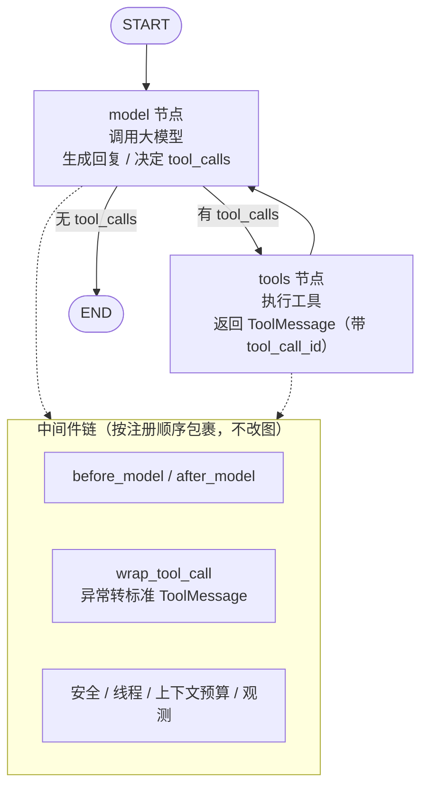
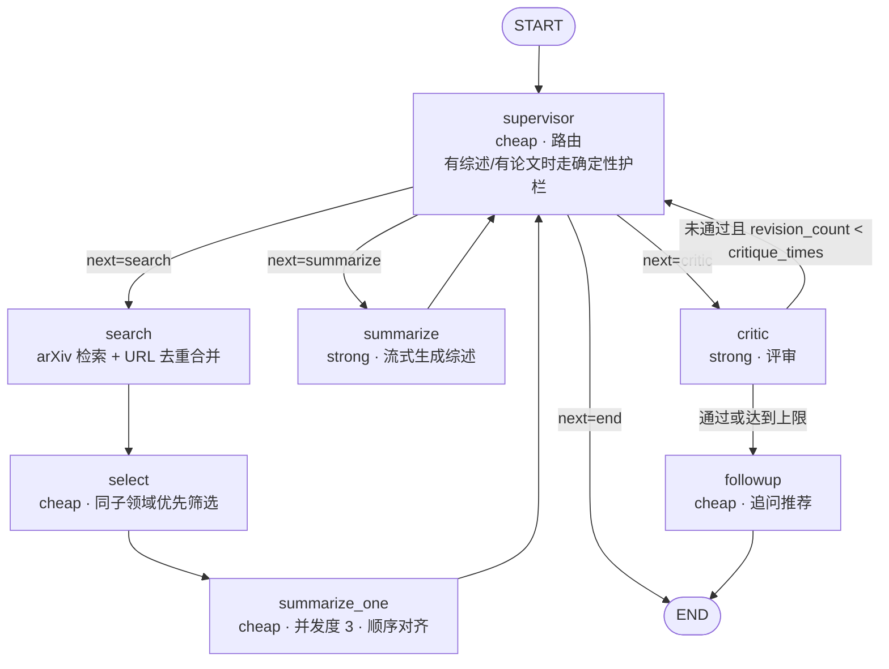

# D54 脱稿 Mock · 讲述纪要与疑问销项

> 说明：`deerflow-questions.md` 不在本仓库，DeerFlow 源码目录当前也无法访问；本文件的疑问清单按历史会话主题（2026-09 至 2026-10 的 DeerFlow 学习记录）重建，逐条标注「已解决 / 待回补」。
> 交付口径：本文件是脱稿讲述的文字纪要与检查表；录音与计时由本人执行，按文末检查表记录卡壳点。

## 一、脱稿架构图 A：DeerFlow

不看书先画这张图，要求能说出：状态字段、两个节点、ReAct 循环、条件边位置、扩展注入点。

口述要点：

- 主图由 LangChain v1 `create_agent` 工厂生成，只有 `model` 和 `tools` 两个节点，标准 ReAct 循环；没有手写 `add_node/add_edge`。
- 状态是 `ThreadState`（`thread_state.py`）：`messages`、`sandbox`、`thread_data`、`title`、`artifacts`、`todos`、`uploaded_files`、`viewed_images`、`delegations`、`skills`；部分字段用自定义 reducer 做多步增量合并。
- 扩展全部走中间件钩子：链首最外层、链尾最内层，`after_model` 按注册逆序执行；顺序由 append 决定，扩展用 `@Next/@Prev` 锚点，最后做不变式校验。
- 组装期六阶段：入口 → checkpoint 模式冻结（fail-closed）→ 配置解析 → 模型决策链 → 可观测性注入 → 工具组装与授权 → 中间件链 → prompt 渲染与图编译；每个请求全量重组，授权前置到组装期。
- 工具：`@tool` 装饰器，`runtime: Runtime` 首参，schema 由类型注解生成；内置工具进 `BUILTIN_TOOLS`，外部工具在 `config.yaml` 用 `module:attr` 声明；工具调用靠 `tool_call_id` 配对，中间件短路也必须保留。
- 子 Agent 不是图节点，而是通过 `task` 工具动态调用；启用需要请求开关与服务端 `allowed_subagents` 同时允许。
- 观测回调必须挂在图调用根节点，否则会话 ID 丢失。

## 二、脱稿架构图 B：本项目 Paper Research Agent

口述要点：

- 状态是 `SupervisorState`（TypedDict，13 字段），以任务产物为中心：`papers`、`paper_summaries`、`summary`，控制位是 `next`、`revision_count`、`search_attempts`。
- 只有两处条件边：`supervisor.route`（按 `next` 分发）和 `critic` 后的 `after_critic`（通过或到轮数上限则 `followup`）。
- 终止四道：`revision_count >= critique_times`、`search_attempts >= MAX_SEARCH_ATTEMPTS`、主题无效 `end`、`RECURSION_LIMIT=60`。
- 横切能力不在节点里：缓存、限流、重试、混沌都在 `models/remote.py` 的 `invoke_llm/stream_llm`；观测在 `observability.py` 注入 `graph.invoke`。

## 三、两图差异（至少三条，实际准备 6 条）

| # | 维度 | DeerFlow | 本项目 | 谁托管了什么 |
| --- | --- | --- | --- | --- |
| 1 | 图来源 | `create_agent` 工厂生成 2 节点 ReAct | 手写 `StateGraph`，7 节点 + 2 条件边 | 框架托管 ReAct 循环，本项目自己托管业务步骤 |
| 2 | 控制流 | 模型 `tool_calls` 驱动循环，中间件做护栏 | 状态位 + 确定性护栏显式决策 | DeerFlow 把「下一步」交给模型；本项目把「下一步」交给状态机 |
| 3 | 扩展方式 | 中间件钩子（before/after_model、wrap_tool_call） | 节点实现 + `llm` 门面横切 | DeerFlow 框架托管横切编排；本项目只借鉴思路，自己实现缓存/限流/重试 |
| 4 | 状态模型 | `ThreadState` 以 `messages` 为中心，多字段自定义 reducer | `SupervisorState` 以任务产物为中心，单 run 增量字典 | DeerFlow 面向长会话；本项目面向一次性任务 |
| 5 | 工具与子 Agent | 工具注册体系 + `task` 子 Agent + MCP | 只有 arXiv 一个工具，无子 Agent | DeerFlow 框架托管工具协议与子 Agent；本项目自己写 pydantic 结果校验 |
| 6 | 组装与持久化 | 每请求重组、checkpoint 模式冻结、fail-closed | 模块导入时装配，`validate_config` 启动校验，单 worker 无持久化 | DeerFlow 托管装配安全；本项目用启动校验 + 单进程锁替代 |

## 四、完整讲述稿（DeerFlow → 借鉴/改造 → 框架版 vs 手写版）

我先把 DeerFlow 讲清楚。它的主图其实是框架生成的：`create_agent` 产出 `model` 和 `tools` 两个节点，`model` 决定要不要调工具，有 `tool_calls` 就去 `tools`，执行完带着 `tool_call_id` 回到 `model`，没有工具调用就结束，是一个标准 ReAct 循环。状态是 `ThreadState`，核心是 `messages`，另外挂 `sandbox`、`todos`、`artifacts`、`skills`、`delegations` 这些字段，部分字段用自定义 reducer 做增量合并。它所有能力都靠中间件注入：安全、上下文预算、工具收尾、观测，不改图；中间件顺序由注册顺序决定，扩展用 `@Next/@Prev` 插入，最后做不变式校验。组装期每个请求全量重组，checkpoint 模式先冻结，配置不匹配就 fail-closed，授权也前置到组装期。工具是 `@tool` 加 `runtime: Runtime` 首参，内置的进 `BUILTIN_TOOLS`，外部的用 `config.yaml` 点号路径反射加载；子 Agent 不是节点，是 `task` 工具动态调起的。

然后讲我怎么借鉴。第一，我把横切关注点从节点里剥出来：项目里的节点只写业务，缓存、key 池、重试、混沌、token 统计全部沉到 `models/remote.py` 和 `usage.py`，这相当于 DeerFlow 中间件思路的简化版。第二，状态集中定义，`SupervisorState` 一个 TypedDict 说清所有字段，节点只返回增量。第三，观测挂在根调用上：`observability.trace_config` 注入 `graph.invoke`，一次研究一条 Trace，节点是 Span，真实模型调用是 Generation。第四，装配期校验：`validate_config` 在启动时检查 provider、key、模型名，避免跑到一半才发现配置错。

但我没有照搬它的图。DeerFlow 的 ReAct 循环适合开放式任务，而我的流程步骤是固定的，所以手写了 7 节点状态机，只保留两处条件边，并且用确定性护栏把 `supervisor` 的模型调用压到只在开局发生。这是我的取舍：牺牲自主性，换可预测、可测试、可估算成本。

最后讲手写极简 Agent 和框架版的差别。手写版自己管一切：循环、工具调用、重试、缓存、限流、SSE、进程锁，好处是每一行都能解释，坏处是扩展一个新能力要动多处。框架版把这些托管掉：ReAct 循环、工具协议、中间件顺序、checkpoint、子 Agent，好处是生态完整，坏处是控制流隐式，出问题要先理解框架契约。我的项目是中间路线：用 LangGraph 托管图执行和条件边，但不使用 `create_agent` 的隐式循环；缓存与限流自己实现，因为这两块直接决定成本和稳定性，必须能解释每个数字。

## 五、历史疑问清单销项

| # | 疑问 | 结论 | 状态 |
| --- | --- | --- | --- |
| 1 | `researcher` / `coder` / `reviewer` 节点和边在哪？ | 不存在，是早期概念稿；现为 `task` 子 Agent 动态调用，不是硬编码节点 | 已解决 |
| 2 | State 在哪、有哪些字段？ | `ThreadState`（`thread_state.py`），含 `messages/sandbox/thread_data/title/artifacts/todos/uploaded_files/viewed_images/delegations/skills`，部分字段有自定义 reducer | 已解决 |
| 3 | 主图几个节点、条件边在哪？ | 2 节点（`model`、`tools`）；`model` 后按有无 `tool_calls` 条件路由，`tools` 回 `model` | 已解决 |
| 4 | 三个中间件构建函数区别？ | `_build_runtime_middlewares` 共享底座；`build_middlewares` 主装配（Gateway 主 Agent 的权威顺序）；`_assemble_from_features` 是 SDK 平行路径 | 已解决 |
| 5 | 中间件顺序怎么定？ | 构建时 append 顺序决定；扩展用 `@Next/@Prev` 锚点；不变式校验兜底；`after_model` 逆序执行 | 已解决 |
| 6 | 工具怎么定义和注册？ | `@tool` + `runtime: Runtime` 首参；内置进 `BUILTIN_TOOLS`，外部用 `config.yaml` 的 `module:attr`；`get_available_tools` 统一装配 | 已解决 |
| 7 | 工具短路为什么保留 `tool_call_id`？ | 结果与调用配对/对账，丢了会导致 ToolMessage 无法回填 | 已解决 |
| 8 | 组装期流程与安全闸？ | 六阶段；checkpoint 模式先冻结、配置不匹配 fail-closed；授权前置；每请求全量重组 | 已解决 |
| 9 | 子 Agent 启用条件？ | 请求开关 + 服务端 `allowed_subagents` 同时允许；空列表硬拒绝，请求只能关闭不能放宽 | 已解决 |
| 10 | 观测回调挂哪？ | 图调用根节点；挂错会丢 session id、断链 | 已解决 |
| 11 | `ContextBudget` / `select_injectable_facts` / `build_memory_context` 的具体阈值与调用顺序 | 只确认了存在位置与职责，具体阈值、截断顺序、与 `auto_load` 的交互没有复述出来 | 待回补 |
| 12 | `debounce` 默认时间与触发边界 | 只记得是防抖，不记得默认值，也没验证并发下的行为 | 待回补 |
| 13 | MCP 与内置工具的边界 | 明确 MCP 是跨进程外部协议、内置是同进程 Python 函数；但 MCP 的授权与超时细节未展开 | 待回补 |

**待回补的查证路径**：重新拉取 DeerFlow 仓库后，`grep -rn "ContextBudget\|debounce\|auto_load" deerflow/` 定位实现，读构造参数与调用点；MCP 部分看 `get_available_tools` 里 MCP 适配分支与 config schema。补齐后把上表状态改为「已解决」，并在本文档追加一段口述。

## 六、脱稿检查表（本人执行录音/计时后填写）

| 段落 | 目标 | 实际用时 | 卡壳点 / 表述不清的概念 | 处理 |
| --- | --- | --- | --- | --- |
| DeerFlow 图 | 2:00 | 待填 | 待填 | 待填 |
| 本项目图 | 1:30 | 待填 | 待填 | 待填 |
| 差异 3 条以上 | 1:30 | 待填 | 待填 | 待填 |
| 借鉴与改造 | 2:00 | 待填 | 待填 | 待填 |
| 框架版 vs 手写版 | 1:30 | 待填 | 待填 | 待填 |
| 合计 | 8:30–9:30 | 待填 | — | — |

脱稿标准：两图节点与条件边说全；差异至少 3 条且能举例；不照 README 念；卡壳点必须记录，不许跳过。
